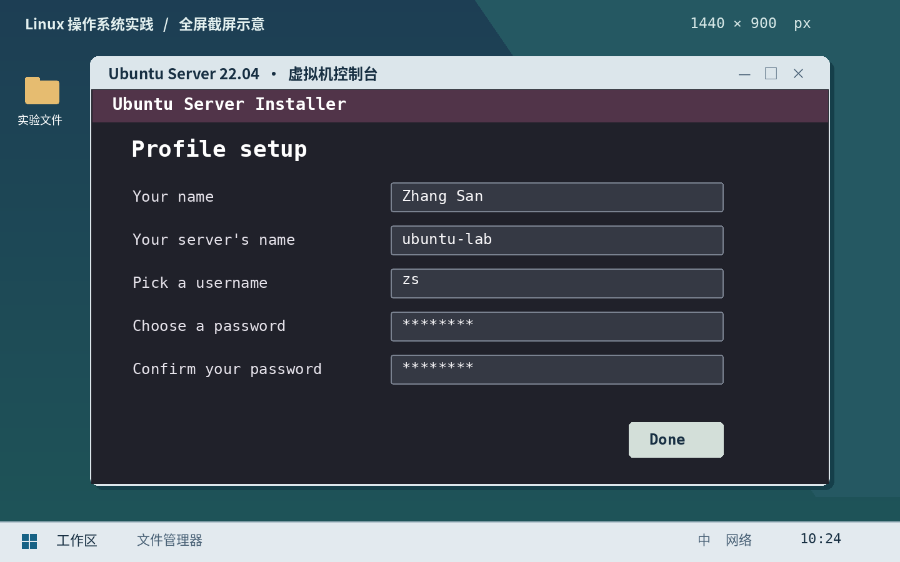

## 截图范围

**每一张实验截图都必须包含显示屏的全部可见信息：从左上角第一个像素，到右下角最后一个像素。** 例如，实际输出为 1920 × 1080 像素的单屏画面，应保留从 `(0, 0)` 到 `(1919, 1079)` 的全部像素。其他分辨率按本机实际尺寸取图。

- **在宿主机上取图。** 虚拟机、Xshell 或浏览器以窗口运行时，宿主机桌面及当时可见的任务栏、标题栏、地址栏均在截图范围内。虚拟机已占满显示屏时，直接从宿主机截整屏即可。
- **多显示器。** 先把本步骤涉及的窗口放在同一块实验显示屏上。选择能直接截取这块完整屏幕的模式；工具若总是把多屏合成一张，可在取图前临时切换为单屏显示，然后重新截全屏。
- **长输出或长网页。** 第一屏拍清命令或页面地址与起始结果，向下滚动后再拍下一屏，相邻两张保留几行重叠内容。每一次取图都要包含整块显示屏。请勿用滚动长图或多张拼图代替逐屏记录。

## 在宿主机上怎样截

1. **先整理画面。** 关闭聊天、邮件和无关网页，收起通知。调大终端字体或浏览器字号，让命令及关键结果在 Word 中也能辨认。把真实密码、密钥移出可见区域，或先返回验证结果页。如果原图意外含有秘密，回到合适的画面重新取图。
2. **停在需要的瞬间。** 安装确认页先截图再点下一步；终端等命令输出结束；网页等地址和结果都显示。请使用自己的操作画面。
3. **选择整屏模式。** 按下表操作。虚拟机占用键盘时，先用虚拟机软件的“释放输入”功能交还宿主机，再调用宿主机截图工具。

| 宿主机 | 操作方法 |
| --- | --- |
| Windows 10 / 11 | 打开“截图工具”，在截图模式中选“全屏截图”。也可按 `Win + Shift + S` 调出截屏栏，再选“全屏”图标。打开结果预览，核对四角并保存 PNG。 |
| macOS | 同时按 `Shift + Command + 3` 截取整屏。多屏会分别生成图片，选择实验所在显示屏的那一张。 |
| Linux 图形桌面 | 在宿主机打开截图工具，选择“整个屏幕 / Screen”并拍摄。GNOME 桌面可按 `Print Screen` 调出截屏界面；其他桌面按其截图工具中的模式名选择。 |

4. **保存并检查原图。** 在图片属性或信息中核对像素宽高。高分屏以实际截得的显示像素为准。再看四边是否保留现场内容；单凭宽高相同不能证明全屏，例如把局部放大到相同尺寸仍缺少画面。保存为 PNG 可让小字号更清楚。
5. **放入报告。** 在 Word 中用“插入 → 图片”选原图，按比例缩放；需要突出某个字段时，在图下用文字指出其位置。保留原图四边，不使用 Word 的“裁剪”。图注写“在哪一步、对什么做了什么、得到什么结果”。

以下图像均为绘制的**版式示意**，示例账号、地址和结果仅用于说明取图范围。点击图片可查看原始尺寸。

<h2 id="installer">安装向导：在点击下一步前截</h2>

**看这几处。** 左上、右下及其余两个角都属于宿主机显示屏；中间才是虚拟机窗口。保持 “Profile setup”、虚拟机名称和 “Pick a username” 同屏，密码框显示掩码。图注示例：“实验一，创建用户：我在英语安装界面将登录名设为 `zs`。”

<h2 id="terminal">终端：把命令、身份和结果放在同一屏</h2>

**看这几处。** 先显示普通用户提示符和 `whoami` 的结果，再执行 `sudo su` 与第二次 `whoami`。待 `root` 出现，留在当前界面取图。图注示例：“实验二，验证提权：第一次查询身份为 `zs123`，提权后同一会话返回 `root`。”

**局部截屏反例。** 下图摘自同一示意图。虽然读得到 `root`，但显示屏四边、会话标题和前一步的账号都已丢失。这种图片需要重新全屏截取。

<h2 id="browser">浏览器：让地址与验收结果同时可见</h2>

**看这几处。** 退出隐藏地址栏的浏览器全屏模式，使网页地址与标题、正文一起可读，再截整块显示屏。图注示例：“实验三，发表文章：宿主机访问 `/zsblog/` 下的文章链接，页面显示我刚发布的标题和正文。”同理，phpMyAdmin 建库图要看到 `pma后三位` 的访问路径、库名及操作结果。

[返回报告提交与评分](submission.html) · [Microsoft 截图工具说明](https://support.microsoft.com/en-us/windows/apps/use-snipping-tool-to-capture-screenshots) · [Apple 截屏说明](https://support.apple.com/en-us/102646) · [GNOME 截屏说明](https://help.gnome.org/gnome-help/screen-shot-record.html)
