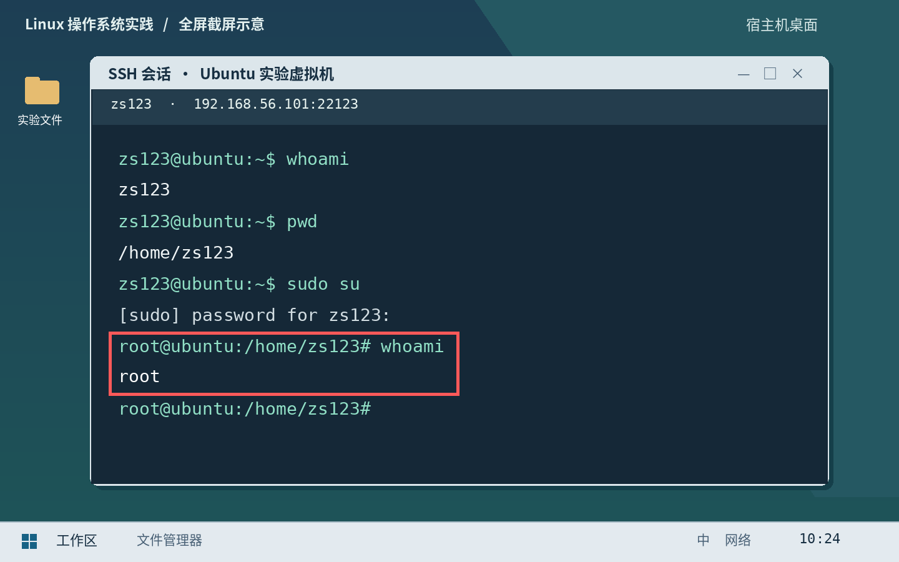
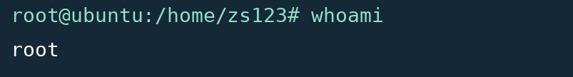
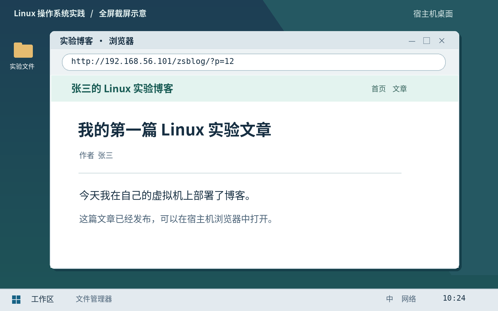

## 截图范围

**截屏时你在显示屏上看到的内容，都要完整出现在图里。** 例如，在 Windows 桌面运行虚拟机时，从顶部标题栏、整个虚拟机窗口，到底部任务栏和右下角时间，都应能看到。其他桌面按实际画面检查；时间显示在顶栏，就把顶栏一起保留。

- **选整块显示屏。** 在宿主机使用“全屏截图”。如果你有多块显示屏，把实验窗口移到同一块，截取这一整块显示屏。
- **重点用红框标出。** 先截全屏，再用红色空心矩形圈出需要老师看的内容，例如用户名、清华源地址或 `whoami` 的结果。红框留一点边距，让文字完整可读。
- **超过一屏就分张截。** 第一张保留命令或网页地址与起始结果，再向下滚动截下一整屏。相邻两张保留几行相同内容，方便连起来看。

## 在宿主机上怎样截

1. 调大终端或浏览器字号。安装时停在需要记录的页面，终端等结果出现，网页等地址和正文都显示。
2. 按下表选择宿主机的全屏截取方式。若按键被虚拟机接收，先用虚拟机的“释放输入”功能把键盘交回宿主机。
3. 打开截图，对照取图时的屏幕检查四边和四角，尤其是标题栏、任务栏和时间。如果只剩中间的窗口，回到该步骤重截。
4. 将全屏图插入 Word，等比例缩放。要标重点，可在“插入 → 形状”选矩形，将“形状填充”设为“无填充”，“形状轮廓”选红色，把框拖到要说明的位置。也可以在截图工具里直接画红框。图下注明操作及实际结果。

| 宿主机 | 操作方法 |
| --- | --- |
| Windows 10 / 11 | 打开“截图工具”，在截图模式中选“全屏截图”。也可按 `Win + Shift + S` 调出截屏栏，再选“全屏”图标。打开结果预览，核对四角并保存 PNG。 |
| macOS | 同时按 `Shift + Command + 3` 截取整屏。多屏会分别生成图片，选择实验所在显示屏的那一张。 |
| Linux 图形桌面 | 在宿主机打开截图工具，选择“整个屏幕 / Screen”并拍摄。GNOME 桌面可按 `Print Screen` 调出截屏界面；其他桌面按其截图工具中的模式名选择。 |

以下图像均为绘制的**版式示意**，示例账号、地址和结果仅用于说明取图范围。三张全屏示例均可点击查看原始尺寸。

<h2 id="installer">安装向导：在点击下一步前截</h2>

**看这几处。** 左上、右下及其余两个角都属于宿主机显示屏；中间才是虚拟机窗口。让 “Profile setup”、虚拟机名称和 “Pick a username” 同屏。图注示例：“实验一，创建用户：我在英语安装界面将登录名设为 `zs`。”

<h2 id="terminal">终端：把命令、身份和结果放在同一屏</h2>

**看这几处。** 先显示普通用户提示符和 `whoami` 的结果，再执行 `sudo su` 与第二次 `whoami`。待 `root` 出现，留在当前界面截全屏。图中的红框圈出了第二次 `whoami` 和返回的 `root`，桌面和任务栏仍完整可见。图注示例：“实验二，验证提权：第一次查询身份为 `zs123`，提权后同一会话返回 `root`。”

**局部截屏反例。** 下图摘自同一示意图。虽然读得到 `root`，但显示屏四边、会话标题和前一步的账号都已丢失。这种图片需要重新全屏截取。

<h2 id="browser">浏览器：让地址与验收结果同时可见</h2>

**看这几处。** 退出隐藏地址栏的浏览器全屏模式，使网页地址与标题、正文一起可读，再截整块显示屏。图注示例：“实验三，发表文章：宿主机访问 `/zsblog/` 下的文章链接，页面显示我刚发布的标题和正文。”同理，phpMyAdmin 建库图要看到 `pma后三位` 的访问路径、库名及操作结果。

[返回报告提交与评分](submission.html) · [Microsoft 截图工具说明](https://support.microsoft.com/en-us/windows/apps/use-snipping-tool-to-capture-screenshots) · [Apple 截屏说明](https://support.apple.com/en-us/102646) · [GNOME 截屏说明](https://help.gnome.org/gnome-help/screen-shot-record.html)
